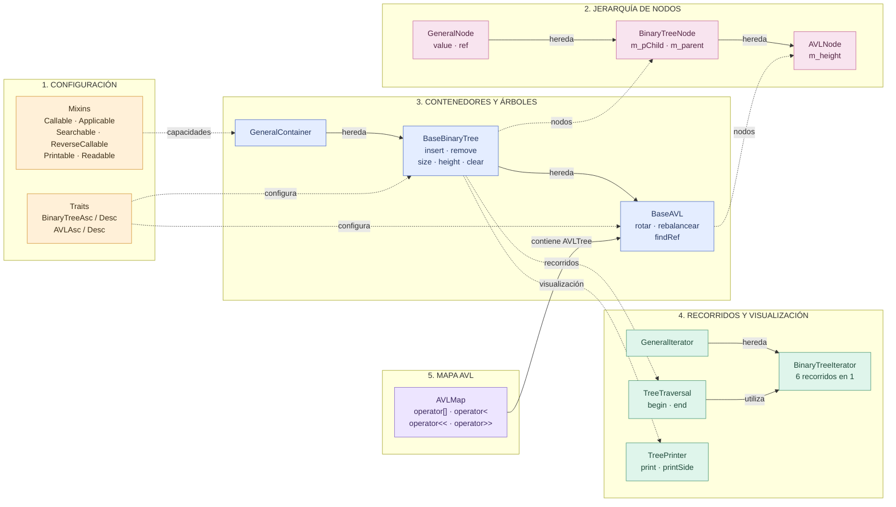
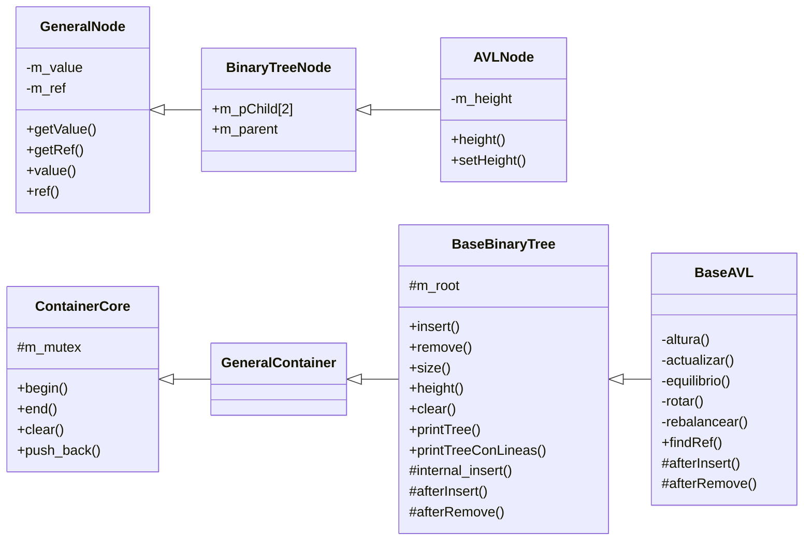
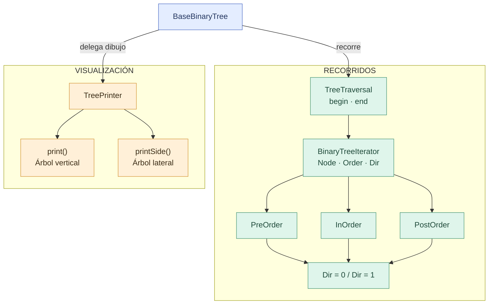
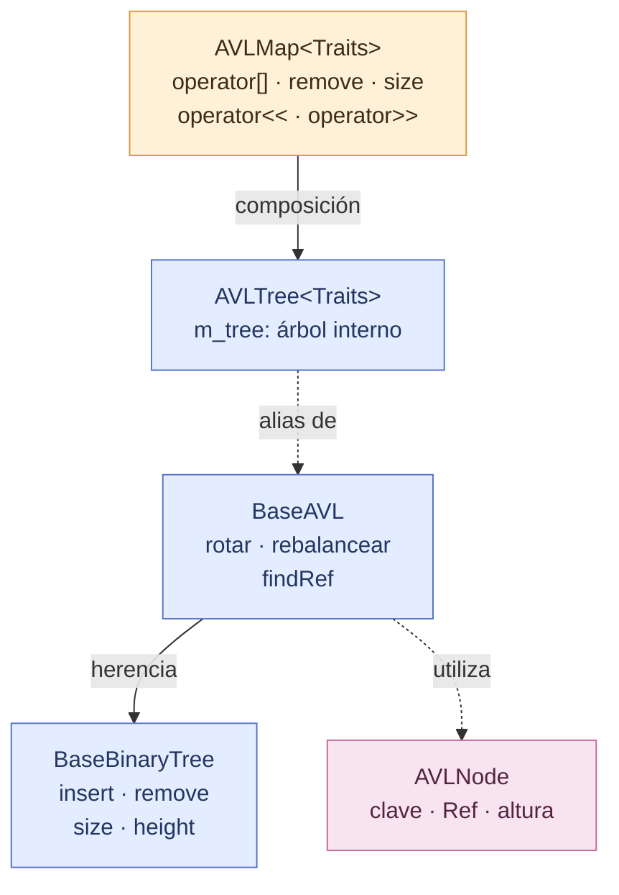

# Arquitectura de BinaryTree, AVLTree y AVLMap

**2026-II-CS-UNI-CC0E5-AEDAv**

## I. Arquitectura del sistema

### 1. Vista general de clases y subsistemas

### 2. Jerarquía de clases

<strong>Ver jerarquía de nodos y contenedores</strong>

**Relaciones principales:**
- `AVLNode` extiende `BinaryTreeNode` con la altura.
- `BaseAVL` extiende `BaseBinaryTree` con rotaciones y rebalanceo.
- `BinaryTree` y `AVLTree` son alias de plantilla que configuran las clases base con sus mixins.

### 3. Sistema de recorridos y visualización

<strong>Ver iteradores y TreePrinter</strong>

| Orden | Dirección 0 | Dirección 1 |
|---|---|---|
| PreOrder | PreOrder | ReversePreOrder |
| InOrder | InOrder | ReverseInOrder |
| PostOrder | PostOrder | ReversePostOrder |

Los seis recorridos se implementan mediante una única plantilla `BinaryTreeIterator<Node, Order, Dir>`.

### 4. Arquitectura de AVLMap

<strong>Ver composición y conexión con AVLTree</strong>

**AVLMap** utiliza un único `AVLTree` interno. `operator[]` busca la clave mediante `findRef()` y, si no existe, la inserta para devolver una referencia modificable al dato asociado.

---

## II. Archivos principales

| Archivo | Componentes |
|---|---|
| `containers/GeneralNode.h` | `GeneralNode` |
| `containers/binarytree.h` | `BinaryTreeNode`, `BinaryTreeIterator`, `TreeTraversal`, `BaseBinaryTree` |
| `containers/avl.h` | `AVLNode`, `BaseAVL`, `AVLTree` |
| `containers/avlmap.h` | `AVLMap` |
| `containers/treeprinter.h` | `TreePrinter` |
| `containers/GeneralIterator.h` | `GeneralIterator` |
| `containers/GeneralContainer.h` | `GeneralContainer` |
| `containers/ContainerCore.h` | `ContainerCore` |
| `containers/mixins.h` | Mixins de operaciones |
| `Demos.cpp` | Demostraciones y pruebas |

---

